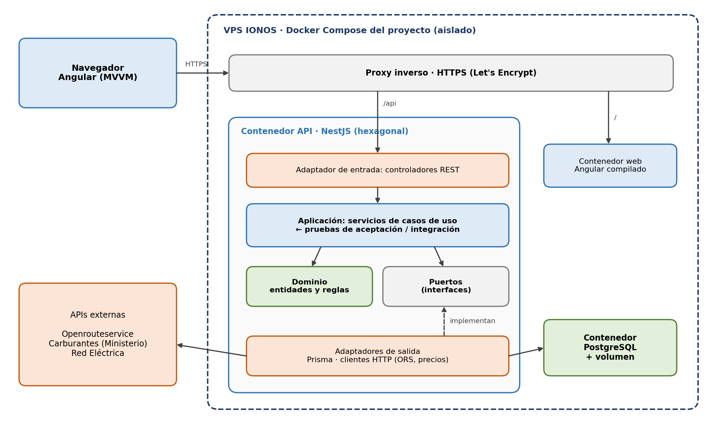

# Aplicación de movilidad

Aplicación web para calcular rutas entre lugares de interés según el método de movilidad (coche de combustión o eléctrico, bicicleta, a pie), con su trayecto, distancia, duración y coste en euros o calorías, sobre un mapa.

Proyecto conjunto de **EI1039 Diseño de Software** y **EI1048 Paradigmas de Software** — Grado en Ingeniería Informática, Universitat Jaume I, curso 2026-2027. Desarrollado con **ATDD** (*Acceptance Test Driven Development*).

## Equipo

- María Sol Parra
- Robert Batiste Ginés
- Vicent Navarro
- Tomás Francisco Nieves

## Tecnologías

| Capa | Tecnología |
|---|---|
| Frontend | Angular 22 · TypeScript · Angular Material · Leaflet (patrón MVVM) |
| Backend | NestJS 12 · TypeScript (arquitectura hexagonal) |
| Base de datos | PostgreSQL · Prisma |
| Pruebas | Vitest · Testcontainers |
| Infraestructura | Docker Compose · GitHub Actions |

## Arquitectura



## Estructura del repositorio

```
apps/
  web/      → frontend Angular
  api/      → backend NestJS
scripts/    → utilidades del equipo (p. ej. crear ramas de historia)
docs/       → documentación y diagramas
.github/    → integración continua y plantillas de issues y pull requests
```

## Puesta en marcha en local

**Requisitos:** Git, Node.js 24 LTS (incluye npm 11) y Docker Desktop.

```bash
git clone https://github.com/TOMASUJI/movilidad-app.git
cd movilidad-app
npm install
npm test
```

`npm install` instala las dependencias de las dos aplicaciones y activa los hooks de Git del proyecto.

| Comando | Qué hace |
|---|---|
| `npm test` | Ejecuta las pruebas de la API y de la web |
| `npm run start:api` | Arranca la API en modo desarrollo |
| `npm run start:web` | Arranca la web en http://localhost:4200 |
| `npm run historia -- 05` | Crea la rama `h-05` desde la iteración actual |

## Cómo trabajamos

Ramas por iteración (`it-NN`) y por historia (`h-XX`), pull requests `ITnn-Hxx` e `ITnn`, y commits `tipo(itNNhXX): descripción`. Toda la guía paso a paso está en [CONTRIBUTING.md](CONTRIBUTING.md).
